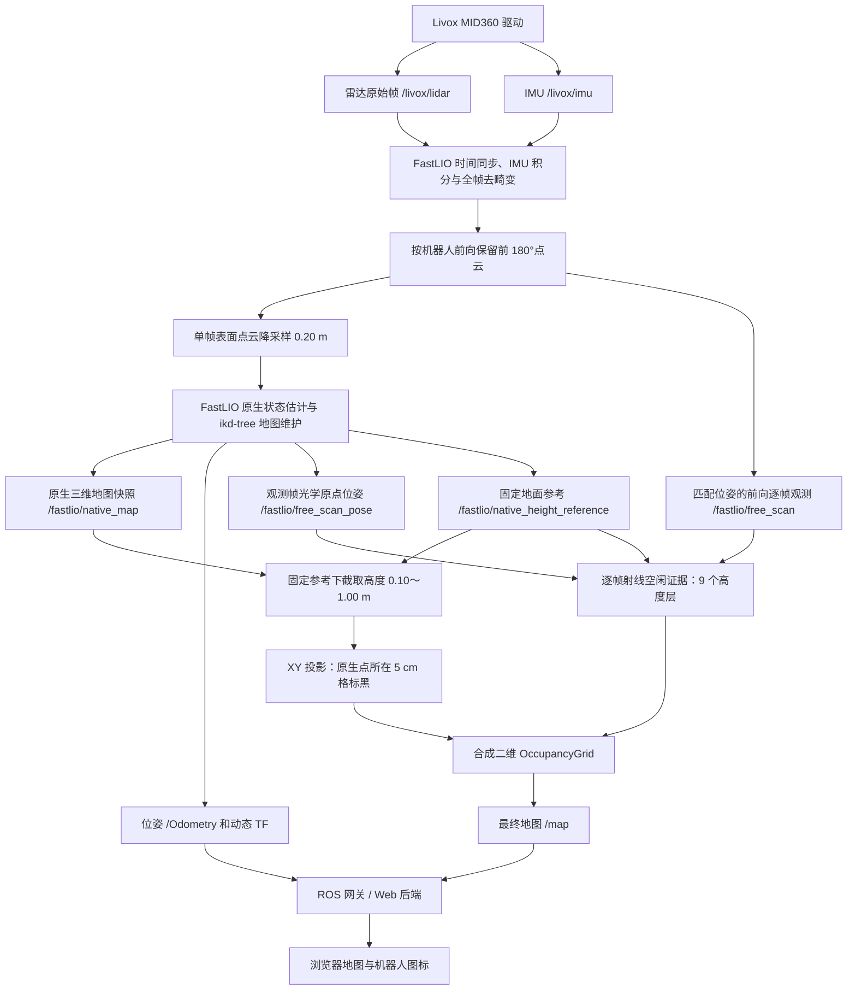

# 手动建图前端接入说明

更新日期：2026-10-23（Asia/Shanghai）  
适用版本：`/home/wheeltec/manual_native180_20261022` 当前已部署版本。启动脚本、launch 和参数已通过 SSH 只读核对；源码与安装目录中的 launch、参数一致。本文整理现有行为，没有部署新的 Web 服务或修改机器人程序。

本文面向 Web 前端及机器人侧后端开发人员。目标是通过网页启动/结束手动建图，显示最新二维地图和机器人位置，并取得保存后的地图路径。前端无需启动 rosbag，也无需处理诊断点云。

## 1. 先看接入结论

| 项目 | 当前实际值 |
| --- | --- |
| 机器人用户 | `wheeltec` |
| 机器人 Tailscale IP | `100.68.26.12` |
| 原 ROS 工作空间 | `/home/wheeltec/zzj_ws` |
| 当前建图部署目录 | `/home/wheeltec/manual_native180_20261022` |
| 当前建图工作空间 | `/home/wheeltec/manual_native180_20261022/ws` |
| 建图入口 | `/home/wheeltec/manual_native180_20261022/start_manual_native180.sh` |
| **最终二维地图 topic** | **`/map`** |
| 地图消息类型 | `nav_msgs/msg/OccupancyGrid` |
| **二维地图坐标系** | **`native_projection`** |
| 地图分辨率 | `0.05 m/格` |
| 机器人位姿 | `/Odometry`；坐标转换后叠加到地图 |
| 地图保存根目录 | `/home/wheeltec/maps/manual_native180` |
| rosbag | 本入口默认不录制，Web 接入无需另启 |
| 底盘 / 导航 | 本入口不启动底盘驱动、Nav2，也不发布运动指令 |
| HTTP / WebSocket 服务 | 本建图入口本身不提供，需接入现有网关或由机器人侧后端封装 |

这是一套**手动建图**入口：建图启动后，由操作者通过已有的独立控制方式驾驶机器人。网页上的“开始建图”不等于“开始自主探索”，也不应同时触发导航。

## 2. 机器人本机启动指令

以下命令在机器人上以 `wheeltec` 用户执行；Web 后端同样在机器人上启动该命令。命令里不需要 SSH，不需要手动 source ROS 环境，也不需要 rosbag 命令。

### 2.1 Web 后端调用：关闭 RViz

```bash
bash /home/wheeltec/manual_native180_20261022/start_manual_native180.sh start_rviz:=false
```

这是当前推荐给 Web 后端的入口。网页通过 `/map` 显示地图，不需要在浏览器中转发 RViz 窗口。

**当前入口仍有图形桌面前置检查：** `start_manual_native180.sh` 即使收到 `start_rviz:=false`，仍要求以下两项有效：

```text
/tmp/.X11-unix/X0
/run/user/1000/gdm/Xauthority
```

核对时机器人上两项均有效。关闭 RViz 与完全无桌面运行是两回事；尚未验证或实现“无图形桌面也可使用该包装脚本”。如果机器人重启后没有图形会话，命令可能在启动建图前退出并输出：

```text
Robot desktop DISPLAY=:0 unavailable.
Robot desktop authorization unavailable.
```

前端应把此信息作为启动失败原因展示，不要无期限显示“建图中”。不要通过跳过包装脚本、直接启动另一个 FastLIO 来规避；包装脚本同时负责环境隔离、互斥和会话归档。

### 2.2 人工在机器人桌面测试：同时打开 RViz

```bash
bash /home/wheeltec/manual_native180_20261022/start_manual_native180.sh
```

默认 `start_rviz:=true`，RViz 显示在机器人桌面 `DISPLAY=:0`。

### 2.3 启动后等待初始化

启动脚本会输出本轮独立保存目录，例如：

```text
SESSION_DIR=/home/wheeltec/maps/manual_native180/native180_20261023_123040_L6aZPn
```

后端应解析并保存**本轮的 `SESSION_DIR`**，作为会话标识和结果目录。不要靠“取 maps 目录里最后一个文件夹”识别本轮结果。

机器人在平坦地面保持静止，等待：

```text
NATIVE_HEIGHT_REFERENCE_READY
PROJECTION_READY
```

固定高度参考需要至少约 3 秒的合格静止数据，还受 IMU 稳定性、帧数等条件限制；不能把“启动后固定等待 3 秒”当作必定初始化完成。参考准备好且收到本轮有效 `/map` 后，再向操作者显示“可开始手动行驶”。首张地图可能尚无白色空闲区域，这是正常的证据累积过程。

### 2.4 环境与互斥

包装脚本会自动加载：

```text
/opt/ros/humble/setup.bash
/home/wheeltec/zzj_ws/install/local_setup.bash
/home/wheeltec/manual_native180_20261022/ws/install/local_setup.bash
```

并固定使用：

```text
ROS_DOMAIN_ID=0
ROS_LOCALHOST_ONLY=0
```

机器人侧 ROS 网关应接入同一个 ROS Domain。浏览器与机器人之间的数据传输由已有 HTTP/WebSocket 网关负责；Tailscale IP 本身不会把 ROS topic 自动变成网页接口。

包装脚本包含进程冲突检查和 `flock` 互斥。已有雷达/建图进程，或另一会话正在运行时，会拒绝重复启动。后端应同时禁止重复点击启动，显示原始错误，不要另开一个会话重试。

不要用原工作空间中的旧手动建图 launch 替代本文入口，那些入口可能仍是旧的 SLAM、OctoMap 或架体补充层链路。

## 3. 当前整条建图链路



### 3.1 前向 180°的实际含义

- MID360 驱动仍接收、发布原始完整帧；没有更改雷达硬件扫描扇区。
- 为保持时间与 IMU 去畸变正确，先处理完整帧，再按安装对应的机器人前向保留前半区。
- 裁剪后的点用于后续匹配、原生地图维护和本实验的逐帧空闲观测。前方判断沿现有安装对应的机器人 `+X` 方向。
- 这会减少裁剪之后的部分计算量；不表示接收、预处理和去畸变的全部计算量减半。

### 3.2 三维累计地图

三维主链使用 FastLIO 原生估计器及 ikd-tree 的增量维护规则。导出的 `/fastlio/native_map` 是**该时刻原生树中实际保留点的快照**，不是前端累计逐帧点云，也不是额外写了一套障碍累计地图。

当前关键参数：

| 参数 | 当前值 | 含义 |
| --- | --- | --- |
| `filter_size_surf` | `0.20 m` | 单帧表面点云降采样参数 |
| `filter_size_map` | `0.10 m` | 原生地图体素参数 |
| 二维分辨率 | `0.05 m` | 最终地图格子边长 |
| 二维障碍高度 | `0.10～1.00 m` | 相对固定地面参考的高度 |
| 雷达底座最底部离地 | `0.20 m` | 建立固定参考时使用的安装测量值 |
| 空闲高度分层 | `0.10 m × 9 层` | 覆盖 `0.10～1.00 m` |

原生点是匹配用代表点，10 cm 体素不等于每个点代表一个完全被占满的 10 cm 立方体，也不等于测量精度为 10 cm。

### 3.3 地面参考与高度投影

初始化时利用静止 IMU、状态和安装高度，建立固定参考 `native_projection`。当前没有动态地面平面拟合或沿途自动更新地面参考。

每次收到新的原生地图快照，将点转换到该固定参考中：

1. 取高度处于 `0.10～1.00 m` 的原生点。
2. 按 XY 位置落入二维 5 cm 格。
3. 只要该格有一个符合条件的原生点，就标记为障碍 `100`。

**当前二维障碍投影没有“同一角度只取最近点”的规则。** 它不经过 LaserScan 压缩。符合高度条件的原生点全部参与投影，多个高度落入同一个 XY 格时合并为同一个黑格。

### 3.4 白色空闲区域

空闲证据由匹配时间戳的 `/fastlio/free_scan` 和 `/fastlio/free_scan_pose` 计算。观测点是去畸变后的前向点，处于 20 cm 单帧表面降采样之前；观测位姿使用该帧匹配的光学原点位姿。

- 某 XY 格的 9 个高度层均获得射线空闲证据，且该格没有原生地图障碍时，输出白色 `0`。
- 原生地图障碍优先，不能被空闲证据覆盖。
- 原始观测中高度带内的端点，会清除该列旧的空闲证据；但本支路没有持久保存障碍命中历史，最终黑格仍来自原生树。
- 其余格输出未知 `-1`，显示灰色。

这里的“各层有射线证据”是当前实现的判定条件，不构成整个体积绝对无障碍的证明。镂空架体托盘附近的白/灰小孔仍在分析中，前端应如实显示原始消息。

### 3.5 本入口的边界

当前入口使用 FastLIO 原生三维地图、高度投影与射线空闲证据。它没有启动旧版的 slam_toolbox、OctoMap 或架体补充层，也没有人体语义过滤或回环优化模块。

前端不要叠加旧的 `/map_rack_overlay`，也不要自行做闭运算、删孤立点或把未知区域标白。视觉配色和业务层可以独立设计，但原始占据数据应保留。

## 4. ROS topic 接口

### 4.1 前端最小订阅集合

| Topic | ROS 2 类型 | 坐标系 / 用途 | 是否必须 |
| --- | --- | --- | --- |
| **`/map`** | `nav_msgs/msg/OccupancyGrid` | 最终二维地图，`header.frame_id=native_projection` | 必须 |
| `/tf` | `tf2_msgs/msg/TFMessage` | 动态坐标变换，含 `camera_init → body` | 显示机器人位置时需要，或由后端处理 |
| `/tf_static` | `tf2_msgs/msg/TFMessage` | 静态变换，含 `camera_init → native_projection` | 同上 |
| `/Odometry` | `nav_msgs/msg/Odometry` | 机器人位姿，父坐标 `camera_init`，子坐标 `body` | 使用此位姿源时需要转换坐标 |

最简地图页面只订阅 `/map`。如需机器人图标，推荐机器人侧后端通过 TF 将位姿变换到 `native_projection` 后再发给浏览器；浏览器不必自行实现完整 TF 缓存。

### 4.2 可选查看与内部计算 topic

| Topic | 类型 | frame / 说明 | 前端是否需要 |
| --- | --- | --- | --- |
| `/fastlio/native_map` | `sensor_msgs/msg/PointCloud2` | `camera_init`；完整原生三维树快照 | 仅三维查看或诊断 |
| `/cloud_registered` | `sensor_msgs/msg/PointCloud2` | `camera_init`；当前帧注册点云，非累计地图 | 通常不需要 |
| `/cloud_registered_body` | `sensor_msgs/msg/PointCloud2` | `body`；当前帧注册点云 | 通常不需要 |
| `/path` | `nav_msgs/msg/Path` | `camera_init`；轨迹，可选显示且需转换 | 可选 |
| `/fastlio/native_height_reference` | `geometry_msgs/msg/PoseStamped` | `camera_init`；固定投影参考的原点与朝向 | 内部使用；后端可用作参考就绪信号 |
| `/fastlio/free_scan` | `sensor_msgs/msg/PointCloud2` | `native_scan_lidar`；匹配帧的前向观测 | 内部空闲证据计算 |
| `/fastlio/free_scan_pose` | `geometry_msgs/msg/PoseStamped` | `camera_init`；同时间戳观测光学原点位姿 | 内部空闲证据计算 |
| `/livox/lidar` | `livox_ros_driver2/msg/CustomMsg` | MID360 原始完整帧，非本方案最终前向地图 | 驱动输入，不建议转发网页 |
| `/livox/imu` | `sensor_msgs/msg/Imu` | 原始 IMU 输入 | 不需要 |

`native_scan_lidar` 是逐帧观测消息使用的 frame 名。不能假定存在一条可直接查询的同名 TF；该观测的正确变换由**同时间戳**的 `/fastlio/free_scan_pose` 提供。它也不是机器人图标的位姿来源。

本 launch 不启动 `pointcloud_to_laserscan`，因此不保证提供 `/scan`。它也不提供机器人控制接口。前端仅显示地图时无需依赖 `/scan`。

### 4.3 QoS 与频率

| Topic | 当前发布策略 | 订阅注意事项 |
| --- | --- | --- |
| `/map` | Reliable / Transient Local / Keep Last 1 | 推荐订阅相同策略，支持页面后打开时取得最近一张地图 |
| `/fastlio/native_height_reference` | Reliable / Transient Local / Keep Last 1 | 后端可迟加入并取得固定参考 |
| `/fastlio/native_map` | Best Effort / Volatile / Keep Last 1 | 订阅者必须兼容 Best Effort；它不是历史缓存 |
| `/cloud_registered`、`/cloud_registered_body` | Best Effort / Volatile / Keep Last 1 | 不应按 Reliable-only 订阅而期待匹配 |
| `/fastlio/free_scan`、`/fastlio/free_scan_pose` | Best Effort / Volatile / Keep Last 5 | 内部按精确时间戳配对 |
| `/Odometry` | Reliable / Volatile / Keep Last 20 | 当前帧位姿，正常约 10 Hz |

地图快照定时器名义为 1 Hz；二维地图在收到、处理有效原生快照后更新。实际接收/录制频率可能低于 1 Hz，不能以“每秒必有一张”作为接口承诺。前端应显示最后更新时间，后端结合进程状态、参考状态和消息新鲜度判定运行状态。

如果现有 ROS-Web 网关不支持 Transient Local 或缓存，需在网关侧验证迟订阅行为，不能假定浏览器发出 subscribe 后会立即收到旧图。`/tf_static` 同样需要处理静态变换的迟加入接收。

## 5. 前端地图绘制和机器人叠加

### 5.1 OccupancyGrid 字段

必须读取每条消息中的：

```text
header.frame_id
header.stamp
info.resolution
info.width
info.height
info.origin.position
info.origin.orientation
data
```

当前输出：

| `data` 值 | 含义 | 与保存 PGM 一致的灰度 |
| --- | --- | --- |
| `100` | 障碍 | `0`，黑色 |
| `0` | 当前规则判为空闲 | `254`，白色 |
| `-1` | 未知 / 证据不足 | `205`，灰色 |

如果传输层把有符号 int8 当成无符号字节，未知值可能表现为 `255`，需要在网关/解码层正确恢复 `-1`；不要把它当作障碍概率 255。

数据按行存放：

```text
index = j * width + i
```

`i` 从左到右，`j` 从下到上。当前地图原点朝向为单位四元数，格心的世界坐标为：

```text
x = origin.x + (i + 0.5) * resolution
y = origin.y + (j + 0.5) * resolution
```

Canvas 原点在左上角时，对应像素行为 `height - 1 - j`。若将来 `origin.orientation` 不再为单位四元数，绘图和点击坐标转换必须额外应用该旋转，不能继续套用只有平移的公式。

### 5.2 整张替换，画布可能变化

`/map` 发布的是完整地图快照，非增量补丁。每次收到新地图，都应按本条消息的尺寸和原点替换原图。

当前画布由**所有高度的原生地图点**的 XY 外包络决定，再加约 0.5 m 边距；计算画布时不只看 0.10～1.00 m 内的点。因此：

- `width`、`height`、`origin` 可能随建图改变。
- 外围可以有大面积灰区；这不等于前端收到错误地图。
- 不要固定复用第一张图的原点或尺寸，否则会出现平移、错位或像“漂移”的显示问题。
- 不要将多张 `/map` 逐像素叠加成永久画布，否则旧点和旧灰区可能残留。
- 为节省网页渲染开销，可以裁剪显示外围未知区，但必须保留裁剪偏移，保证机器人叠图和点击坐标正确。裁剪不能修改存档地图的几何关系。

### 5.3 位姿必须转换到地图坐标系

当前相关 TF 关系：

```text
camera_init
├── body                 动态：FastLIO 估计的机器人/IMU body 位姿
└── native_projection    静态：本轮固定地面投影参考
```

`/map` 是 topic 名，**不表示消息坐标系也叫 `map`**。本实验的实际地图 frame 是 `native_projection`。

机器人图标应使用 `body` 在 `native_projection` 中的位姿。后端可通过 TF 查询目标 frame `native_projection`、源 frame `body`。不能直接把 `/Odometry.pose` 中的 XY 画在二维图上，因为该 pose 表达在 `camera_init` 中。

如后端直接使用固定参考计算位置：设 `/fastlio/native_height_reference` 给出的原点为 `g`，朝向矩阵为 `R`（参考轴在 `camera_init` 中的表示），机器人位置为 `p`，则列向量形式为：

```text
p_native_projection = transpose(R) * (p_camera_init - g)
```

朝向同样要变换，再取平面 yaw。通常优先使用 TF 库处理，避免行列向量、逆变换和四元数顺序错误。

`body` 是当前 FastLIO 位姿参考，不代表已经校准的底盘几何中心。如果产品要求图标/机器人外形严格对应底盘中心，应使用项目中已确认的安装变换，不能在前端凭经验另加偏移。

## 6. Web 后端进程管理与停止保存

### 6.1 启动进程的所有权

后端应在机器人上创建一个受管理的长生命周期子进程，记录 PID、启动时间和 `SESSION_DIR`，持续读取 stdout/stderr。不要把启动命令绑在一个随 HTTP 请求结束就销毁的临时 shell 上。

以 Python 后端为例，以下是**接入示例，尚未部署为现有 HTTP API**：

```python
import signal
import subprocess

mapping_process = subprocess.Popen(
    [
        "bash",
        "/home/wheeltec/manual_native180_20261022/start_manual_native180.sh",
        "start_rviz:=false",
    ],
    stdout=subprocess.PIPE,
    stderr=subprocess.STDOUT,
    text=True,
    bufsize=1,
    start_new_session=True,
)

# 启动后：由独立日志读取任务持续消费 mapping_process.stdout，
# 解析 SESSION_DIR、初始化、保存和退出状态；示例未展开 Web 框架代码。
```

在独立的“结束并保存”处理函数中，使用该会话持有的同一个进程对象：

```python
mapping_process.send_signal(signal.SIGINT)
# 等待进程退出；保存完成前页面保持“保存中”，不要立即报告成功。
```

“开始”和“停止”属于两个操作，不能在启动处理函数中连着执行。HTTP 客户端断开时，日志读取任务仍应继续，否则 PIPE 堵塞可能影响运行；Web 服务进程重启后的 PID/会话恢复需按现有后端架构实现。

### 6.2 机器人终端停止指令

前台人工启动时按一次 `Ctrl+C`。Web 后端或另一终端需要停止时，使用**本轮记录的 `run_session.py` 监督进程 PID**：

```bash
kill -INT <本轮监督进程PID>
```

包装脚本最终通过 `exec` 进入监督进程；正常直接调用本文入口时，后端创建并持有的进程 PID 就是应发送信号的 PID。若外面另套进程管理器，以该管理器实际持有的进程关系为准。

监督进程收到 SIGINT 后会向所属 ROS launch 转发一次退出请求。它也处理 SIGTERM/SIGHUP，但推荐正常结束操作使用 SIGINT。

不要使用全局 `pkill ros2`、`killall`、模糊 `pkill -f` 或 `kill -9` 作为正常保存操作；那会绕开本轮进程管理或打断保存，也可能影响其他服务。

### 6.3 保存完成的判断

停止时通常依次出现：

```text
STOP_REQUESTED: waiting for final 2D/3D saves; please keep power on.
MAP_SAVED ...
NATIVE_MAP_SAVED ...
SESSION_SAVED: /home/wheeltec/maps/manual_native180/native180_...
```

其中二维与三维保存日志的相互先后不应当写死。`MAP_SAVED` 在运行时周期保存也可能出现，**单独看到它不能判断本轮已经停止**。

结束按钮点击后，后端应等待监督进程退出，并检查本轮结果文件、保存日志与退出状态。`SESSION_SAVED` 当前只检查五个必需文件是否存在，不代表地图质量验收通过，也不能覆盖同时发生的进程错误。

以下情况需明确显示失败或“结果已保存但进程退出异常”：

```text
SESSION_SAVE_INCOMPLETE
MAP_SAVE_FAILED
```

现场已有退出阶段被 ROS launch 在约 5 秒后升级到 SIGTERM 的记录，部分驱动还出现过非零退出码；对应地图文件仍可有效保存。后端不能只用“退出码非零就删除结果”，也不能只用“有文件就完全成功”。不要因 HTTP 请求超时立即强杀；保存应作为持续任务管理。

### 6.4 建议前端状态

以下状态供后端封装使用，不是现有 ROS 状态 topic 或已部署 API：

| 状态 | 进入条件 / 页面行为 |
| --- | --- |
| `idle` | 没有本后端管理的建图会话 |
| `starting` | 命令已执行，尚未确认参考与地图就绪 |
| `mapping` | 本轮参考就绪且已收到有效 `/map`；显示地图与更新时间 |
| `saving` | 用户已请求正常结束，正在等待退出与保存 |
| `saved` | 正常结束且本轮必需结果文件检查通过 |
| `saved_with_warning` | 结果文件存在，但进程退出/日志有异常，需要保留提示 |
| `error` | 启动失败、关键进程异常，或结果不完整 |

单有 PID 不足以证明建图正常；反过来，Web 网关缓存的一张旧地图也不能证明当前进程还活着。后端应把会话身份、进程状态和数据新鲜度一起提供给前端。

### 6.5 Web 接口建议

若现有后端尚无建图接口，可以把以下动作映射到已有接口规范：

| 动作 | 后端职责 | 推荐返回内容 |
| --- | --- | --- |
| 开始建图 | 互斥检查、启动第 2.1 节命令、捕获日志 | 会话 ID、状态、开始时间 |
| 查询状态 | 查询本轮受管进程及地图新鲜度 | 状态、最后地图时间、初始化状态、错误信息 |
| 结束并保存 | 对本轮监督进程发一次 SIGINT，异步等待结果 | 会话 ID、`saving` 状态；完成后更新结果 |
| 取得结果 | 读取本轮明确目录中的地图文件 | 地图 YAML/图像下载地址、分辨率、原点、frame、完成状态 |

URI、端口、鉴权方式和框架由现有 Web 项目确定。本文不假定已有 `/mapping/start` 等 HTTP 路由，也不为机器人新增开放端口。

## 7. 保存结果与文件含义

每次启动生成独立目录：

```text
/home/wheeltec/maps/manual_native180/native180_YYYYMMDD_HHMMSS_XXXXXX/
```

| 文件 | 含义 | 前端是否需要处理 |
| --- | --- | --- |
| `map.yaml` | 二维地图元数据；引用同目录 `map.pgm` | 保存/导航地图管理需要 |
| `map.pgm` | 最终二维栅格，黑/白/灰 | 地图下载、历史预览需要 |
| `projection_stats.json` | 最后保存地图的时间戳、参考、计数和参数摘要 | 后端可读取，辅助状态与元数据 |
| `projection_source_camera_init.pcd` | 精确生成保存二维图所用的原生快照 | 诊断，不必传网页 |
| `native_map_final_camera_init.pcd` | 停止时/调用保存服务时导出的原生三维地图 | 三维存档，不必传网页 |
| `free_evidence.npz` | 保存地图对应的空闲证据缓存 | 内部证据，不必传网页 |
| `native180_fastlio.yaml`、`projection.yaml` | 本轮参数备份 | 后端留存 |
| `deployment_manifest.json` | 部署版本信息 | 后端留存 |
| `logs/`、`fastlio_logs/` | 运行和诊断日志 | 故障时查看 |

保存的二维精确来源应看 `projection_source_camera_init.pcd`。最终原生 PCD 与最后二维快照可能有少量时间差，不保证两者逐点完全相同。

二维地图、源点云和缓存约每 60 秒自动保存一次，并在正常结束时再次保存。最终原生 PCD 在正常退出时保存；不能把前面的二维周期保存理解为三维最终文件也每 60 秒同步落盘。

前端无需操作 rosbag 或上述诊断文件。当前脚本仍会自动保存这些证据与日志，这是现有会话行为；“不录 rosbag”不等于关闭自动地图保存。

PGM 不是所有浏览器都原生支持，历史预览可由后端提供 PNG。转换时保留原始 PGM/YAML，并正确携带分辨率、原点、尺寸和 frame；仅有一张 PNG 不能恢复地图坐标。

### 7.1 现有三维保存服务

```text
服务：/native_map_save
类型：std_srvs/srv/Trigger
```

该服务只负责原生三维 PCD，**不是“保存二维地图”的服务，也不会结束建图**。它原来在 FastLIO 中叫 `/map_save`，本入口已重映射为 `/native_map_save`。

本版本没有对外提供专门的二维“立即保存”服务。Web 第一版可直接提供“结束并保存”；如果需要“建图不中断时保存一个完整可命名版本”，需单独设计接口，不能把 `/native_map_save` 当成完整功能。

## 8. 首次联调检查

本次文档核对未实际启动新的建图或导航。前端首次接入时，建议按以下顺序验收：

1. 以 `wheeltec` 用户通过 Web 后端运行第 2.1 节命令，确认没有重复启动，捕获正确 `SESSION_DIR`。
2. 机器人静止初始化，网页明确显示“初始化中”，就绪后才显示“建图中”。
3. 网页收到 `/map`，能正确区分黑/白/灰；重新打开页面能取得当前地图。
4. 地图原点或尺寸改变时，画面和机器人位置仍保持一致。
5. 机器人图标已变换到 `native_projection`，没有把 `camera_init` 坐标直接混入地图。
6. 点击“结束并保存”，只停止本轮会话，等待保存状态结束，取得本轮 `map.yaml` 和 `map.pgm`。
7. 停止后网页保留历史图，但清楚标记“已停止/历史结果”，不能继续显示实时建图。
8. 检查没有由此次接入额外启动 rosbag、底盘或 Nav2。

## 9. 已知地图表现与导航边界

两轮现场数据已确认：A 区域为约 60 cm 高架体，B 区域为约 50 cm 高架体，两者下方均镂空。规定高度覆盖两者，录包中可见对应高度的多帧回波。当前二维图仍可能呈点状并存在托盘附近的小孔；前端不要自行填孔掩盖原始结果。

当前这张地图可以作为 Nav2 的候选地图输入。默认 Nav2 的足迹和膨胀层会使部分原图小孔在代价地图中不可进入，因此地图是否可导航不能只看黑格是否连续。定位、TF、实时局部避障以及实际代价地图与路径，仍需单独联调。

**本入口的 `native_projection` 建图坐标，与 Nav2 习惯使用的 `map` frame 不应由前端简单改名混用。** 导航阶段通过地图加载、定位和正确 TF 建立关系；前端显示地图或开放目标点按钮，不代表已完成导航链路接入。

## 10. 实现位置

以下均是机器人路径，供后端定位实现；修改需另行按项目流程审批：

```text
/home/wheeltec/manual_native180_20261022/start_manual_native180.sh
/home/wheeltec/manual_native180_20261022/run_session.py
/home/wheeltec/manual_native180_20261022/ws/src/native_height_projection/launch/manual_native180.launch.py
/home/wheeltec/manual_native180_20261022/ws/src/native_height_projection/config/native180_fastlio.yaml
/home/wheeltec/manual_native180_20261022/ws/src/native_height_projection/config/projection.yaml
/home/wheeltec/manual_native180_20261022/ws/src/native_height_projection/scripts/native_height_projector.py
/home/wheeltec/manual_native180_20261022/ws/src/native_height_projection/scripts/projection_core.py
/home/wheeltec/manual_native180_20261022/ws/src/native_height_projection/scripts/free_evidence.py
/home/wheeltec/manual_native180_20261022/ws/src/native_height_projection/src/free_evidence.cpp
/home/wheeltec/manual_native180_20261022/ws/src/fast_lio/src/laserMapping.cpp
/home/wheeltec/manual_native180_20261022/ws/src/fast_lio/src/native_height_export.hpp
```

交接时优先以第 2 节启动命令、第 4 节 topic、第 5 节坐标与绘图规则、第 6 节停止保存流程作为接口约定。本文不要求前端修改 FastLIO、射线计算或投影算法。
