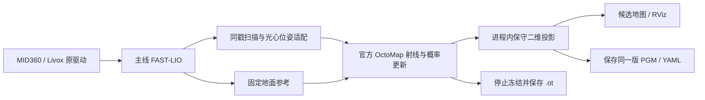

# 草莓架在线占据建图：独立候选工程

状态：2026-11-12 首版实现；未经用户现场测试，不替代现有正式工程。

## 目标与边界

MID360 + Jetson Orin Nano 8 GB；一次约 50–100 m²。实验室桌面约 55 cm，实际草莓架约 65–110 cm，细支撑约 4 cm。希望悬空架体的实测投影成为障碍，人员离开后的旧占据可由后续真实自由射线撤销。地图边建边显示，停止仅保存，不运行 A–E 后处理。全栈新增内存目标 2 GB，首版只记录，用户手动停止；尚无实测证明满足目标。

用户已接受 FAST-LIO + 官方 OctoMap 方向，并要求新文件夹隔离。主体只写本工程及机器人同名独立目录。用户随后单独批准：仅给生产 `external_manual.py` 加入严格会话识别，并在无任务、无租约时重启用户级 Web 管理器；该补丁已部署。旧建图工程、全局环境和 systemd 单元内容不改。源代码构建与静态审查由助手完成，运行、运动、建图、回放及验收均由用户完成。

## 证据与可推翻条件

- 已确认：主线 FAST-LIO 可输出同时间戳的去畸变扫描、扫描末光心位姿及固定地面参考。机器人有 Humble、OctoMap server 2.3.1、liboctomap 1.9.7、Nav2 map_io 和 Livox SDK2。官方服务器提供虚函数与进程内树访问接口。
- 支持的推断：保留成熟的 OctoMap 射线与概率更新，可替代目前“累计端点再投影、离线补撤销”的组合；进程内投影可避免逐帧整树序列化。
- 未验证假设：5 cm 体素能在此采样条件下保留 4 cm 支撑；固定地面参考适合小起伏；真实自由观测足够使人员残影消退；Orin 能及时处理这组扫描。
- 缺少证据：50–100 m² 完整路线的延迟、全进程内存峰值、细腿漏检率、通道未知比例、误清率和室外反射表现。
- 反证：架下射线擦掉同列桌板；无新证据区域变白；细腿稳定漏检；地面起伏大量进入障碍高度带；持续积压或内存超过预算。出现任一项，不能宣布适用，先定位对应模块，不叠加临时补丁。

## 数据流

1. FAST-LIO 保留主线 3 取 1、0.20 m 匹配表面滤波、0.10 m 树插入体素、前向 180°、IMU/外参参数。其 ikd-tree 继续承担定位。新增工程关闭不使用的整树点云、扫描显示、路径及退出 PCD 输出，仍保留 `native_map_export` 观测出口。不是“无降采样版本”。
2. 适配器只配对真实观测，有限缓存，不外推缺失位姿；发布准确光心 TF 和光心坐标中的扫描。固定地面参考变化则停止接受数据，不能混合参考。
3. 后端继承已安装的官方普通 OctomapServer；保留其点云回调、TF 查询、`insertScan`、命中/未命中概率、同帧键去重与八叉树压缩。关闭地面 RANSAC，避免把桌面误判为地面。不按高度预裁端点，低处/高处的真实回波仍能提供中间穿越证据。地面本身可以存于三维树，二维只投影选定高度带。
4. 只替换二维输出：每列在 `[0.10, 1.25) m` 内有占据则黑；全部相关 5 cm 体素已知自由才白；其余灰。遍历真实叶子，处理压缩叶实际范围，缺失子树保留未知。不按面积删除细腿，不按机器人经过强制清整列，不自动补矩形。
5. 建图中约 1 Hz 输出候选二维图，概率融合仍逐有效扫描进行。停止先冻结输入，强制投影当前完整树，保存 `.ot` 概率状态及同一版二维图，再退出进程。没有第二套“优化后地图”。

## 首版参数与明确取舍

| 项目 | 初始值 / 取舍 |
|---|---|
| OctoMap / 二维分辨率 | 0.05 m / 0.05 m |
| 投影高度 | 离固定地面 0.10–1.25 m，半开区间 |
| 概率 | hit .70，miss .40，clamp .12–.97，占据阈值 .50 |
| 占据射线最大距离 | 5 m；超距真实回波按官方规则提供截至量程的自由证据，无伪造端点 |
| 地面 RANSAC / speckle 删除 | 关闭；先保留细结构、隔离地面问题 |
| 三维展示 | 不周期性序列化；保留按需读取树的官方服务 |
| 二维画布 | 最多 1,000,000 格，超限报错，不能静默裁出“完整地图” |
| 内存 | 每 10 s 记录本会话进程；无 2 GB 自动停机；采样峰值不等于瞬时峰值 |

这里采用官方从光心起算的射线，没有移植旧自写自由规则中的 0.50 m 近端 / 0.10 m 终点保护。MID360 的盲区内自由证据及桌腿边缘因此属于需要观察的具体差异。若这一差异导致误清，先以同一组数据定位，再讨论一个独立改动，不能预先叠加保护补丁。

23 个高度层全部自由是保守选择，可能使通道留灰。黑点变灰可以表示旧占据已撤销，并不必然立即变白。被遮挡、没有同高度穿越观测的旧人影不会凭时间自行消失。5 m 量程对狭长棚的远背景清除和建图效率有影响，尚未证明最优。末光心是整帧射线的近似起点，运动时不等于每一点实际发射原点。

只看见架腿且没看见架面时，算法无法凭空知道完整架体轮廓；未知不能直接当可通行。实测架面缺口应记录，而不是用“整片涂黑”掩盖感知不足。

## 隔离与复用

- 自带 FAST-LIO、Livox 源码副本和来源哈希；独立 `ws/build`、`ws/install`、`ws/log`。
- 仅共享已安装的 `/opt/ros/humble` 与系统 Livox SDK、PCL、OctoMap 库。不 source 旧机器人工作空间，不从旧工程加载插件。
- 新节点命名空间、候选话题 `/strawberry_octomap/map`、实验子坐标 `strawberry_ground` / `strawberry_lidar`；FAST-LIO 原有 `camera_init → body` 仅在互斥实验运行时存在，不改生产 TF 配置。
- ROS 同域 `0`、localhost-only `1`；旧会话共享锁只读打开并 flock，补充进程冲突检查；不启动或关闭底盘服务，不发布速度、不绕开控制权检查。
- `outputs/<会话>/` 独立保存二维图、OctoMap、元数据、日志、内存记录；不创建旧格式假 PCD，不加入旧地图库。
- Web 新入口已按单独批准加入生产白名单；补丁、原文件和部署记录位于 `integration/web/`。网页地图通过显式 `--web-map` 别名显示，控制及实际图像交给用户验收。

## 最小用户验收顺序

每轮只验证一个主要问题；首轮保留全部参数。

1. 静止启动：等待固定参考，观察第一幅二维候选、时间戳、内存；无地图时先查输入与配对，不先改滤波。
2. 桌板保护：沿一侧与端部观察 55 cm 桌子，再看桌下；同列桌板不能因低位穿越被擦掉。
3. 细腿：多视角重复观察 4 cm 支撑，记录漏检位置，不靠 speckle 清理修饰结果。
4. 人员离开：先形成占据，人离开后从原区域获得真实背景穿越，比较旧体素状态；遮挡未解除不算有效清除实验。
5. 完整路线：再评估 50–100 m² 的数据龄、内存、未知通道、最终保存；实时图与保存图应对应冻结时同一版本。

助手本轮不代跑以上实验。构建通过仅说明可编译。

## 回滚

退出本候选会话并确认其子进程结束，原目录、参数、启动命令和地图仍在。Web 补丁只新增识别，保留它也不会改变旧入口。如果需撤回补丁，按 `integration/web/README.md` 的基线哈希、备份和空闲重启步骤恢复单个文件。新目录可保留供分析，不执行大范围 reset 或删除。

## 上游依据

- [OctoMap 官方核心](https://github.com/OctoMap/octomap)
- [Humble OctomapServer 2.3.1 源码](https://github.com/ros2-gbp/octomap_mapping-release/tree/release/humble/octomap_server/2.3.1-1)
- [FAST-LIO](https://github.com/hku-mars/FAST_LIO)
- [Livox ROS Driver 2](https://github.com/Livox-SDK/livox_ros_driver2)
- [Nav2 地图存储](https://github.com/ros-navigation/navigation2/blob/humble/nav2_map_server/src/map_io.cpp)
