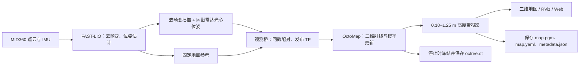
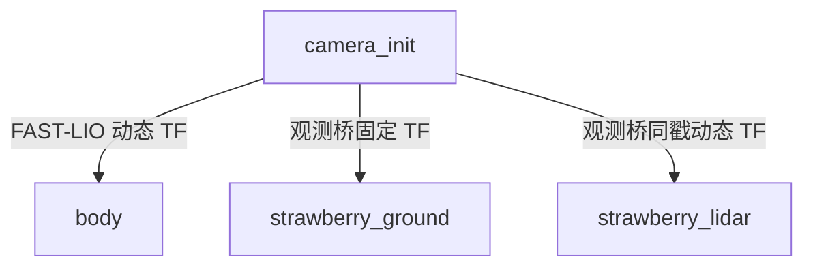

# 草莓机器人手动建图系统：原理与 Web 接口交接说明

版本日期：2026-11-12。适用工程：`strawberry_octomap_20261112`。

本文面向 Web、机器人后端和集成同事，描述当前已经部署、用户正在使用的 **FAST-LIO + OctoMap 在线手动建图版本**。已通过 Tailscale 只读核对机器人启动脚本、会话管理器、内存记录器、主配置、launch 和占据服务器源码，其 SHA-256 与本地一致。本文编写期间没有启动建图、发送运动命令或修改算法。

这里不包含已经放弃的“无降采样版”、旧 A–E 离线优化流程，也不包含讨论中的 NDT-OM 等后续候选算法。旧架构文档中的“首版参数”属于历史信息，当前参数以本文和主配置为准。

## 1. Web 同事先看这几项

| 项目 | 当前约定 |
|---|---|
| 机器人工程根目录 | `/home/wheeltec/strawberry_octomap_20261112` |
| 推荐启动指令 | `bash /home/wheeltec/strawberry_octomap_20261112/start_mapping.sh --web-map` |
| Web 实时二维地图 | `/map`，`nav_msgs/msg/OccupancyGrid`；必须带 `--web-map` 启动 |
| 始终存在的独立地图输出 | `/strawberry_octomap/map`，与 `/map` 是同一张地图的两个发布出口 |
| 地图坐标系 | `strawberry_ground`；**topic 名为 `/map` 不代表 frame 名为 `map`** |
| 地图刷新 | 有新扫描融合时最高约 1 Hz；不是固定心跳；结束保存时额外发布最终图 |
| 地图订阅 QoS | Reliable、Transient Local、KeepLast 1 |
| 就绪条件 | 同一会话出现 `OBSERVATION_READY` 与 `OCTOMAP_MAP_READY`；会话 `phase=mapping` |
| 正常停止并保存 | 松开摇杆、确认车停稳，在启动终端按一次 Ctrl+C，等待 `SESSION_SAVED=...` |
| 地图根目录 | `/home/wheeltec/strawberry_octomap_20261112/outputs/`；**不是旧工程的 `/home/wheeltec/maps/`** |
| 每次保存目录 | `outputs/<32位十六进制会话ID>/` |
| 当前／最近会话索引 | `/home/wheeltec/strawberry_octomap_20261112/runtime/session.json` |
| 内存 | 自动每 10 秒记录；不在启动时编译；没有 2 GB 自动停止 |
| 默认 rosbag | **不自动录制**，没有 `--record-bag` 选项；录制方法见第 11 节 |
| Web 现有集成 | 已增加本工程外部会话识别；复用现有控制权、租约和速度安全检查 |
| Web 尚未集成 | 原网页“开始／停止／保存建图”和原地图库，不自动管理本工程 |
| ROS 通信环境 | ROS 2 Humble，`ROS_DOMAIN_ID=0`、`ROS_LOCALHOST_ONLY=1` |

本工程提供的直接接口是 **CLI、ROS topic/service/TF、会话和结果文件**。它没有新增 HTTP 或 WebSocket API。浏览器仍通过现有机器人端 Web／云桥访问 ROS；不能假设另外存在 `/api/octomap/start` 等接口。

## 2. 系统做什么、怎样生成地图

设备为 MID360 与 Jetson Orin Nano 8 GB。目标是在手动驾驶过程中，把悬空桌面／草莓架及支撑等三维障碍投影成二维导航地图，同时允许后续真实观测撤销人员等旧障碍。



### 2.1 FAST-LIO 负责定位与观测生成

FAST-LIO 利用激光和 IMU 估计运动，并对扫描进行运动去畸变。其内部 ikd-tree 服务于定位，与后面的 OctoMap 占据树是不同的数据结构。

当前仍保留主线预处理：有效点按 3 取 1、近距过滤 0.30 m、前向 180° 裁剪。FAST-LIO 匹配点云体素为 0.20 m，内部地图插入体素为 0.10 m。**送给 OctoMap 的是去畸变观测，不是 FAST-LIO 的累计定位地图；所取点集没有经过这两个定位体素滤波步骤，但已受前述预处理与前向裁剪影响。** 观测实际在本帧位姿更新后发布。

当前关闭无用的累计点云、路径和 PCD 输出。配置中的 `mapping.fov_degree=360` 不能用于推断实际输出是全向，因为 `experiment.forward180=true` 仍生效。

### 2.2 观测桥保持点云与射线起点一致

固定地面参考由 FAST-LIO 的静止窗口建立：至少 3 秒、20 帧，并满足速度、角速度和稳定性条件；使用重力反方向确定 +Z，根据外参和雷达光心到底座的机械偏移得到底座位置，再向下移配置的 0.20 m 确定地面零点。这不是对任意点云直接做 `z−0.20`。

观测桥按完整纳秒时间戳匹配扫描和雷达光心位姿，取得固定地面参考后才转发。它发布同戳光心 TF，并把点云 frame 改为 `strawberry_lidar`，不修改点的 XYZ 或时间戳，不额外抽点或补点。

后端由 TF 同时得到点云与光心在 `strawberry_ground` 下的位置，因此自由射线起点与端点处于同一坐标关系。当前整帧使用扫描末光心作为射线起点近似，不是逐点发射光心。

桥缓存最多 8 个未配对条目、合计 8 MiB 点云载荷，单帧最多 20 万点；等待配对超过 1 秒、缓存超限或旧帧落后于已转发帧时会丢弃。DDS 队列和正在处理的消息不包含在这个缓存上限内。

固定地面参考在一轮中不允许改变；发生变化会报 `OBSERVATION_REFERENCE_CHANGED` 并终止该轮。这里没有沿路线实时重拟合地面，因此较大坡度／地面高差仍会影响高度投影。

### 2.3 OctoMap 在线更新三维占据

本工程继承官方 `octomap_server` 的点云输入、TF 等待、射线遍历和概率更新逻辑，核心为：

1. 在有效量程内，真实回波所在体素获得“占据”证据。
2. 从光心到回波前经过的体素获得“自由”证据。
3. 同一帧按三维体素键去重；同一体素同时收到命中和穿越时，命中优先。
4. 超过 5 m 的真实回波只提供沿其方向到 5 m 的自由证据，不在截断处伪造占据点。
5. 未返回方向不会被补造自由射线。没有新观测的区域也不会仅因时间流逝自动清空。

证据以 log-odds 累积并限制上下界。后来获得足够自由证据时，旧障碍可撤销；若人离开后原位置仍被遮挡，残影不保证消失。

当前关闭地面 RANSAC 分类。投影高度带之外的真实端点仍保留给三维射线计算；不能先把所有低处或高处回波删掉，再把残余点当作完整观测。

### 2.4 三维树投影为二维图

当前最小体素边长和二维栅格分辨率均为 **0.05 m**。投影高度相对固定地面为 **`[0.10, 1.25)` m**，即 23 个高度层。

| 某一 XY 栅格在这 23 层中的状态 | 二维值 | 显示 |
|---|---:|---|
| 至少有一层已知占据 | `100` | 黑色／障碍 |
| 所有层都已知自由，且无占据 | `0` | 白色／自由 |
| 无占据，但仍有未知层 | `-1` | 灰色／未知 |

因此，桌子下面镂空并不自动意味着桌子整列可通行；高度带内的桌面只要仍被判为占据，该列就是障碍。反过来，黑变灰表示占据已撤销但自由证据尚不完整，不能按白色处理。

本版不会把草莓架外接矩形自动填满，不按连通块面积删除细腿，也不因机器人驶过某个 XY 位置就清除整根高度柱。已知薄表面在粗体素中可能被旁边／下方射线削弱，仍属于当前版本的质量边界。

### 2.5 停止保存不是离线优化

实时图和最终图来自同一棵占据树。停止时冻结新扫描，强制生成最后一张二维图，再保存二维图和完整概率树；没有第二套离线“优化后地图”。

`octree.ot` 是三维概率占据树，不是原始点云或 FAST-LIO 的完整点云地图。需要复现输入时必须另录 rosbag。

## 3. 当前配置与参数边界

主配置在机器人：

```text
/home/wheeltec/strawberry_octomap_20261112/ws/src/strawberry_octomap/config/fastlio.yaml
/home/wheeltec/strawberry_octomap_20261112/ws/src/strawberry_octomap/config/octomap.yaml
```

运行时加载独立工作空间 `ws/install/strawberry_octomap/share/strawberry_octomap/config/` 中安装后的文件。修改源码配置后需要按构建流程更新安装产物和构建记录；不能只修改一份 YAML 后假设运行已生效。

| 参数 | 当前值 | 含义 |
|---|---:|---|
| `resolution` | `0.05` m | OctoMap 最小体素与二维像素边长 |
| `occupancy_min_z` / `occupancy_max_z` | `0.10` / `1.25` m | 投影高度带，下闭上开 |
| `sensor_model.hit` | `0.75` | 命中证据权重 |
| `sensor_model.miss` | `0.45` | 自由穿越证据权重 |
| `sensor_model.min` / `max` | `0.12` / `0.97` | 占据概率限制 |
| 树内占据阈值 | `0.50` | 判断三维体素是否占据 |
| `sensor_model.max_range` | `5.0` m | 每条射线的融合距离，不是全图尺寸上限 |
| `filter_ground_plane` | `false` | 不启用地面分类 |
| `filter_speckles` | `false` | 上游选项关闭；当前派生投影本身不做孤立点清理 |
| `compress_map` | `false` | 不执行服务器每帧显式整树 prune；核心更新仍可能合并同值子节点 |
| `incremental_2D_projection` | `false` | 本工程自己完整重投影，不用官方增量二维更新 |
| `point_filter_num` | `3` | FAST-LIO 有效点抽样 |
| `preprocess.blind` | `0.30` m | FAST-LIO 近距过滤 |
| `filter_size_surf` / `filter_size_map` | `0.20` / `0.10` m | 定位匹配／内部地图体素 |
| `experiment.forward180` | `true` | 前向半空间观测 |
| `experiment.sensor_bottom_height` | `0.20` m | 固定地面参考使用的安装高度参数，不等于直接指定光心高度 |
| `pcd_save.pcd_save_en` | `false` | 不保存 FAST-LIO PCD |

`hit/miss` 是观测模型参数，不是“最终图有 75% 概率正确”。落盘 YAML 的 `occupied_thresh=0.65` 用于图像重载，**不是**这里的三维树占据阈值。

占据服务器不支持本轮运行中动态改参数；需要结束、更新并重新启动。初始化要求空树，当前入口没有加载旧 `.ot` 接着建图的功能。

## 4. 启动、停止和构建

### 4.1 日常启动

在机器人 SSH 终端执行：

```bash
bash /home/wheeltec/strawberry_octomap_20261112/start_mapping.sh --web-map
```

无机器人桌面、或只用网页观察时：

```bash
bash /home/wheeltec/strawberry_octomap_20261112/start_mapping.sh --web-map --no-rviz
```

默认在机器人本机桌面打开 RViz，不通过 SSH X11 转发到电脑。启动后先保持静止，等待初始化及两条就绪标记，再在 Web 申请控制权并手动驾驶。

| 启动选项 | 用途 |
|---|---|
| 无选项 | 打开本机 RViz；仅输出独立地图 topic |
| `--web-map` | 额外输出 `/map`，供网页使用 |
| `--no-rviz` | 不启动 RViz，其余建图流程保持一致 |
| `-h`、`--help` | 查看 CLI 帮助 |
| `--build-only` | 维护用，仅构建；通常改用下面的构建脚本 |

内部 `--check-map-topic` 是启动器使用的冲突探测，不是建图模式。没有 `--record-bag`、`--duration` 或 `--memory-limit`。标准 Web 识别只接受已约定的启动参数组合。

启动器持有互斥锁后会检查已有建图／导航／传感器进程。带 `--web-map` 时还要求当前没有 `/map` 发布者；不满足时拒绝本轮启动，而不是只关闭网页输出。已有 `/map` 订阅者，例如录包程序，不构成发布冲突。

### 4.2 避免 SSH 断线结束建图

机器人安装了 `tmux` 时，长时间手动建图建议放在其中：

```bash
tmux new -s strawberry-map 'bash /home/wheeltec/strawberry_octomap_20261112/start_mapping.sh --web-map'
```

SSH 重连后：

```bash
tmux attach -t strawberry-map
```

如要主动离开终端而保持运行，按 `Ctrl+B`，松开后按 `D`。同名会话已存在时应重新连接，不要重复启动第二套建图。

`tmux` 只维持建图终端，不维持 Web 控制租约。网络异常时机器人速度仍由原控制安全机制管理。

### 4.3 正常停止与成功判定

1. 松开 Web 摇杆，确认机器人停稳。
2. 在建图前台按一次 Ctrl+C。
3. 等待保存及节点退出，不要直接关闭进程或使用 `kill -9`。
4. 成功时终端会输出：

```text
STOP_REQUESTED：正在封口并保存地图，请等待完成。
MAP=/home/wheeltec/strawberry_octomap_20261112/outputs/<session_id>/map.yaml
SESSION_SAVED=/home/wheeltec/strawberry_octomap_20261112/outputs/<session_id>
```

启动预检失败输出 `STRAWBERRY_OCTOMAP_FAILED=...`；会话建立后失败输出 `SESSION_FAILED=...`，退出码为 1。正常完成退出码为 0。CLI 参数写错则由 argparse 输出 usage，通常退出码为 2。

协调器收到 SIGINT、SIGTERM、SIGHUP 都会请求同一套保存流程。SIGHUP 可由 SSH 挂断引起，所以普通 SSH 中运行可能因为网络断开而提前结束；它不是推荐停止方式。SIGKILL 无法执行保存收尾。

**停止建图不等价于撤销 Web 控制租约，也不等价于主动发送停车指令。** 本工程没有速度发布器。

### 4.4 维护时构建

```bash
bash /home/wheeltec/strawberry_octomap_20261112/scripts/build_robot.sh
```

构建顺序为 Livox 驱动、FAST-LIO、OctoMap 接入包；使用独立工作空间、单任务编译。正常启动只运行预编译程序，不进行编译。源码或安装产物与 `build_stamp.json` 不一致时，启动器会拒绝启动。

不要绕过 `start_mapping.sh` 直接运行 launch 作为 Web 产品入口：那样会遗漏会话管理、锁、构建校验、内存记录和 Web 识别所需的进程关系。

## 5. 节点与 ROS topic 完整清单

本节列出本工程业务节点的 topic，以及默认注册但不出数据的接口。底盘、相机、原云平台的其他无关 topic 不属于本工程清单。

### 5.1 节点

| 节点全名 | 职责 |
|---|---|
| `/strawberry_octomap/livox_lidar_publisher` | MID360 数据接入 |
| `/strawberry_octomap/fastlio_mapping` | 激光惯性定位、去畸变及观测输出；launch 延迟约 2 秒启动 |
| `/strawberry_octomap/observation_bridge` | 固定参考与同戳观测配对、TF 发布 |
| `/manual_octomap/octomap_server` | 三维占据融合、二维投影、最终保存 |
| `/strawberry_octomap/rviz2` | 可选本机显示 |

前四个核心进程中任意一个退出，会触发本组 launch 关闭。内部地图冲突探测、最终保存请求还会短暂创建辅助 ROS 节点，不代表另一套建图。

### 5.2 默认实际发布的业务 topic

QoS 简写：R=Reliable，BE=Best Effort，TL=Transient Local，V=Volatile，K=KeepLast 深度。频率为配置或触发方式，不是吞吐保证。

| Topic 全名 | 消息类型 | 发布者／使用者与用途 | 发布条件、频率和发布 QoS |
|---|---|---|---|
| `/strawberry_octomap/livox/lidar` | `livox_ros_driver2/msg/CustomMsg` | Livox → FAST-LIO，原始激光包；frame=`livox_frame` | 驱动收到数据后发布；点云配置 10 Hz；R/V/K256 |
| `/strawberry_octomap/livox/imu` | `sensor_msgs/msg/Imu` | Livox → FAST-LIO，IMU；frame=`livox_frame` | 随设备 IMU 数据发布，不能按点云的 10 Hz 理解；R/V/K256 |
| `/strawberry_octomap/fastlio/free_scan` | `sensor_msgs/msg/PointCloud2` | FAST-LIO → 观测桥，预处理和去畸变后的实际扫描；frame=`native_scan_lidar` | 参考就绪且估计成功后逐扫描，通常随约 10 Hz 输入；BE/V/K5 |
| `/strawberry_octomap/fastlio/free_scan_pose` | `geometry_msgs/msg/PoseStamped` | 同扫描末时刻的雷达光心位姿；frame=`camera_init` | 与 `free_scan` 完全同戳成对输出；BE/V/K5 |
| `/strawberry_octomap/fastlio/native_height_reference` | `geometry_msgs/msg/PoseStamped` | 固定地面参考在 `camera_init` 中的位姿 | 参考就绪后约每 1 秒重发，时间戳取最近扫描；R/TL/K1 |
| `/strawberry_octomap/cloud_in` | `sensor_msgs/msg/PointCloud2` | 观测桥 → OctoMap；frame=`strawberry_lidar`，XYZ 与原扫描相同 | 每个有效同戳对转发一次；R/V/K2 |
| `/strawberry_octomap/odometry` | `nav_msgs/msg/Odometry` | FAST-LIO 位姿；header=`camera_init`、child=`body` | 估计成功逐扫描；R/V/K20 |
| `/strawberry_octomap/map` | `nav_msgs/msg/OccupancyGrid` | 占据服务器 → RViz／分析工具，二维完整地图 | 随新扫描最高约 1 Hz，最终保存额外发布；R/TL/K1 |
| `/map` | `nav_msgs/msg/OccupancyGrid` | 占据服务器 → 现有网页地图 | **仅 `--web-map` 时发布**；与独立地图内容完全相同；R/TL/K1 |
| `/tf` | `tf2_msgs/msg/TFMessage` | FAST-LIO 的 `camera_init→body`，观测桥的 `camera_init→strawberry_lidar` | 随相应观测发布；R/V；FAST-LIO K100、桥 K8 |
| `/tf_static` | `tf2_msgs/msg/TFMessage` | 观测桥的 `camera_init→strawberry_ground` | 首个有效固定参考发布；R/TL/K1 |

FAST-LIO 订阅激光为 BE/K2、IMU 为 BE/K10；观测桥订阅扫描和光心为 BE/K2、固定参考为 R/TL/K1。官方 OctoMap 输入订阅为 SensorDataQoS（BE/K5），并通过 TF MessageFilter 等待对应变换。**点云发布者使用 Reliable，不表示所有后续输入一定不丢帧；桥的转发数量也不等于 OctoMap 实际接收数量。**

`free_scan` 名字里的 `free` 不表示这些点是“自由空间点”。它们仍然是真实回波端点，配合光心才可以计算中间自由射线。

### 5.3 注册了 publisher、当前却不发布数据的 topic

这些名字可能出现在 `ros2 topic list` 中；看到名字不代表能收到消息，新增订阅者也不会自动开启。

| Topic | 类型 | 当前为何无数据 |
|---|---|---|
| `/strawberry_octomap/path` | `nav_msgs/msg/Path` | `publish.path_en=false` |
| `/strawberry_octomap/cloud_registered` | `sensor_msgs/msg/PointCloud2` | 扫描显示输出关闭 |
| `/strawberry_octomap/cloud_registered_body` | `sensor_msgs/msg/PointCloud2` | 扫描本体系显示关闭 |
| `/strawberry_octomap/cloud_effected` | `sensor_msgs/msg/PointCloud2` | 匹配有效点显示关闭 |
| `/strawberry_octomap/unused_native_map` | `sensor_msgs/msg/PointCloud2` | FAST-LIO 累计点云输出关闭；由原 `/Laser_map` 重映射 |
| `/manual_octomap/octomap_binary` | `octomap_msgs/msg/Octomap` | 继承 publisher 已注册，但本工程 `publishAll()` 不发三维树 topic |
| `/manual_octomap/octomap_full` | `octomap_msgs/msg/Octomap` | 同上；需要三维树用第 7 节的同名 service |
| `/manual_octomap/occupied_cells_vis_array` | `visualization_msgs/msg/MarkerArray` | 本工程不周期发布三维 marker |
| `/manual_octomap/free_cells_vis_array` | `visualization_msgs/msg/MarkerArray` | 本工程不周期发布自由体素 marker |
| `/manual_octomap/octomap_point_cloud_centers` | `sensor_msgs/msg/PointCloud2` | 本工程不周期导出树中心点云 |

FAST-LIO path publisher 为 R/V/K20，所列 FAST-LIO 点云 publisher 为 BE/V/K1。所列 OctoMap publisher 为 R/TL，通常 K1，自由 marker 为 K5。这些 QoS 不改变其当前没有消息的事实。

### 5.4 ROS 框架 topic

`/rosout`（`rcl_interfaces/msg/Log`）和 `/parameter_events`（`rcl_interfaces/msg/ParameterEvent`）属于 ROS 框架日志／参数事件，不是建图业务状态流。RViz 等工具还可能注册交互 topic，以所运行版本为准；本工程没有把 RViz 的交互 topic 接成导航或运动接口。

本工程不输出二维 `/scan`，不发布 `/cmd_vel` 或 `/cmd_vel_safe`，不启动底盘、Nav2 或 SLAM Toolbox。

## 6. 地图显示与机器人位姿：Web 必须遵守的坐标契约

### 6.1 OccupancyGrid 解释

| 字段 | 当前语义 |
|---|---|
| `header.frame_id` | `strawberry_ground` |
| `header.stamp` | 此图对应的最新已融合扫描时间戳，不是网页接收时间 |
| `info.map_load_time` | 当前实现同样使用该扫描时间戳；不能把它当整轮固定会话 ID |
| `info.resolution` | 0.05 m／格 |
| `info.width`、`info.height` | 当前整张地图的宽高，单位为格 |
| `info.origin.position` | 左下栅格起始边界在地图坐标中的位置，z=0 |
| `info.origin.orientation` | 当前实现单位四元数 |
| `data` | 行优先数组，长度必须等于 `width×height`，取值 -1、0、100 |

栅格坐标为 `(ix, iy)` 时：

```text
index = iy * width + ix
x_center = origin.x + (ix + 0.5) * resolution
y_center = origin.y + (iy + 0.5) * resolution
```

ROS 的第 0 行位于地图低 Y 一侧；HTML Canvas 的第 0 行通常在画面上方。直接从 ROS 数组绘图时使用 `canvas_y = height - 1 - iy` 翻转一次 Y。PGM 文件已经按图像方向写好，不要再按 ROS 数组规则重复翻转。

地图的宽、高和原点都可能随覆盖范围改变。每条消息是完整地图，不是增量补丁；前端应按新的元数据更新图像与坐标变换，不能只追加像素或固定原点。未知值 `-1` 应保留独立颜色，不能映射为白色。

订阅 `/map` 与 `/strawberry_octomap/map` 二选一即可。用 Transient Local 订阅有助于后加入时取得发布者缓存的最新图；这个缓存随发布者进程结束而消失，不是历史地图存储。

地图约 1 Hz 发布，但输入中断时不发送地图心跳。Web 应分别显示地图时间戳、会话状态和控制连接状态，不能把“有缓存地图”当作“建图进程健康”。

### 6.2 TF 关系



在图上绘制机器人，需要查询 `strawberry_ground ← body` 的 TF，或者把 `/strawberry_octomap/odometry` 从 `camera_init` 转到 `strawberry_ground`。不能直接把 Odometry 的 x/y 画到地图像素上。

`body` 是 FAST-LIO 的机体／IMU 参考，不自动等于底盘的 `base_link` 或 `base_footprint`。`strawberry_lidar` 是雷达光心，存在外参偏移；画底盘轮廓时需要既有机体到实际底盘的外参约定。

本工程没有创建全局 `map` frame、`map→odom` 或 `strawberry_ground→base_link` 的直接广播。TF 能通过共同父坐标计算相对变换，不需要为了显示地图再伪造一个单位变换。

现有 Web 管理器的 `/web/robot_pose` 为 `geometry_msgs/msg/TransformStamped`，用于转发当前地图 frame 下的机器人位姿；接入方仍需检查其 frame、时间戳与本次地图一致，不能复用上一轮的位置。其端点属于原管理器，不是本工程新发布的 topic。

### 6.3 ROS 本机发现与网页网络

所有诊断、录包或机器人端 Web ROS 进程需要处于同一环境：

```bash
source /opt/ros/humble/setup.bash
source /home/wheeltec/strawberry_octomap_20261112/ws/install/local_setup.bash
export ROS_DOMAIN_ID=0
export ROS_LOCALHOST_ONLY=1
```

因为启用了本机发现，另一台电脑不能仅凭 Tailscale 连接就直接发现这些 DDS topic。正确链路是机器人上的 Web／云桥订阅 ROS，再把地图与位姿传到浏览器。无需为了网页显示把 `ROS_LOCALHOST_ONLY` 改回 0。

## 7. ROS service 与内部 launch 接口

### 7.1 业务 service

| Service 全名 | 类型 | 请求 | 返回与作用 |
|---|---|---|---|
| `/strawberry_octomap/finalize` | `std_srvs/srv/Trigger` | 空请求 `{}` | 冻结占据更新，生成并保存最终图；成功 `success=true`、`message` 为绝对 `map.yaml` 路径；失败 `success=false`、`message` 为原因 |
| `/manual_octomap/octomap_binary` | `octomap_msgs/srv/GetOctomap` | 空请求 `{}` | 按需返回二值形式的三维树，响应字段 `map`；不保存文件 |
| `/manual_octomap/octomap_full` | `octomap_msgs/srv/GetOctomap` | 空请求 `{}` | 按需返回保留概率信息的完整三维树，响应字段 `map`；不保存文件 |
| `/strawberry_octomap/map_save` | `std_srvs/srv/Trigger` | 空请求 `{}` | FAST-LIO 遗留保存接口；当前返回 `success=false`、`Map save disabled.`，**不是二维图保存入口** |

以上业务服务采用默认服务 QoS：Reliable、Volatile、KeepLast 10。`GetOctomap` 返回的 `map` 类型是 `octomap_msgs/msg/Octomap`，包括 `header`、`binary`、`id`、`resolution`、`data`，`header.frame_id=strawberry_ground`。它的时间戳是服务处理时间，不是实时二维图的扫描时间戳。整树服务有序列化开销，不适合网页每秒轮询。

`finalize` 语义需特别注意：

- 它是“本轮封口”，不是可以继续建图的普通快照保存；失败后也保持冻结。
- 已成功后重复调用，返回同一成功路径，不覆盖重写已有结果。
- 它只冻结／保存，不负责退出 launch、释放会话锁或更新完整会话状态。
- 它可能先发布最终地图、随后写盘失败；收到最终地图并不等于保存成功。
- 正常产品流程应让协调器收到停止信号，由协调器调用服务并完成收尾。

供维护者理解的直接调用方式如下；它会停止后续地图融合，不用于普通在线健康检查：

```bash
ros2 service call /strawberry_octomap/finalize std_srvs/srv/Trigger '{}'
```

本版移除了继承服务器的 `/manual_octomap/octomap_server/reset` 和 `/manual_octomap/octomap_server/clear_bbox` 服务，避免在本轮中绕开会话逻辑修改地图。

ROS 节点通常还提供 `describe_parameters`、`get_parameter_types`、`get_parameters`、`list_parameters`、`set_parameters`、`set_parameters_atomically` 标准参数服务，路径为 `<节点全名>/<服务名>`，类型为对应 `rcl_interfaces/srv/*`。它们不是建图生命周期 API；占据服务器运行时参数修改会被拒绝。

### 7.2 内部 launch 参数

`strawberry_octomap/mapping.launch.py` 接受：

| 参数 | 默认／要求 | 用途 |
|---|---|---|
| `output_dir` | 必填，已存在的绝对目录 | 本轮所有地图和节点工作目录 |
| `start_rviz` | `true` | 是否启动本机 RViz |
| `publish_web_map` | `false` | 是否额外发布 `/map` |

这些参数由 `session.py` 生成。直接 launch 不等价于标准启动，不能满足现有 Web 严格会话识别。

内部保存客户端为 `scripts/finalize_map.py --timeout <秒数>`，要求正且有限的超时值，协调器正常传入 120。这个客户端也只调用封口保存服务，不替代整轮停止入口。

## 8. 会话生命周期、状态文件与保存位置

### 8.1 文件树

```text
/home/wheeltec/strawberry_octomap_20261112/
├── start_mapping.sh
├── session.py
├── memory_monitor.py
├── build_stamp.json
├── runtime/
│   ├── session.json                 当前或最近一轮状态索引
│   └── session.lock                 本工程会话互斥锁
└── outputs/
    └── <session_id>/                每轮新建，不复用旧目录
        ├── map.yaml                二维地图入口
        ├── map.pgm                 二维栅格图像
        ├── octree.ot               完整三维概率占据树
        ├── metadata.json           地图坐标、计数、参数与版本
        ├── session.json            本轮生命周期状态
        ├── mapping.log             launch 与节点主要输出
        ├── finalize.log            保存服务请求结果
        ├── memory.csv              每 10 秒内存样本
        ├── memory_summary.json     结束后的内存汇总
        └── logs/                   ROS 各节点日志
```

通过启动预检后才创建会话目录并打印 `SESSION_DIR=...`。地图四件套在停止保存时才写出，不保证建图过程中已经存在 `map.yaml`。`.ot` 的保存也不意味着下轮能够自动续建。

读取最近会话目录可在机器人执行：

```bash
python3 - <<'PY'
import json
from pathlib import Path
index = Path('/home/wheeltec/strawberry_octomap_20261112/runtime/session.json')
state = json.loads(index.read_text())
print('status =', state['status'])
print('phase =', state['phase'])
print('session =', state['session'])
print('map =', str(Path(state['session']) / 'map.yaml'))
PY
```

`runtime/session.json` 指向最近已登记的会话，可能是失败或尚未完成的一轮。互斥、构建、桌面或 `/map` 冲突等预检失败不会刷新这个索引，因此它也可能仍指向上轮。不能把它当作“本次启动成功”或“最近成功地图”的证明。历史地图库应检查各轮状态和文件完整性后收录，不依赖目录名排序；会话 ID 本身不编码时间。

### 8.2 状态字段

状态同时写入本轮 `session.json` 和 `runtime/session.json`。每份文件使用临时文件替换，**两份之间不是跨文件事务**；读取时应核对会话 ID，并允许短暂状态不同步后重读。

| 字段 | 含义 |
|---|---|
| `status` | `running`、`complete`、`failed` |
| `phase` | 运行时 `starting`、`mapping`、`saving`；终态 `complete`／`failed` |
| `session` | 绝对会话目录 |
| `session_id` | 32 位十六进制 ID |
| `supervisor_pid`、`supervisor_starttime` | 协调器 PID 与 Linux 进程开始 tick；两者共同用于身份校验 |
| `child_pid`、`child_starttime` | ROS launch PID 与开始 tick；首次 starting 状态时可能尚未写入 |
| `rviz`、`web_map` | 是否启用 RViz 与 `/map` |
| `source_fingerprint` | 本轮源码指纹 |
| `started_epoch`、`finished_epoch` | Unix 秒，后者只在结束时写入 |
| `stop_signal` | 首个停止信号：2=SIGINT、15=SIGTERM、1=SIGHUP；无停止请求时不一定有 |
| `finalize_exit_code` | 保存请求客户端退出码，0 表示收到成功响应 |
| `launch_exit_code` | launch 最终退出码 |
| `finalize_timed_out` | 请求辅助进程超过协调器外层约 130 秒仍未结束、被强制终止时设置；普通客户端超时通常没有此字段 |
| `mapping_fatal_error`、`error` | 固定参考改变等故障／最终失败原因，如发生则出现 |
| `memory_recording_error`、`memory_summary_error` | 内存文件记录故障，如发生则出现 |

阶段关系：

```text
starting → mapping → saving → complete
    任一阶段出现未完成的故障 → failed
```

这是简化图：初始化期间也允许请求停止，但没有已知地图时保存会失败。`phase=mapping` 表示曾经通过就绪条件，并不是持续活性心跳；应结合进程身份和最新数据时间戳判断是否停滞。SIGKILL、异常断电等可能留下 `running` 和旧 PID，活跃判断必须同时校验 PID 与开始 tick，不能只看 JSON。

完整成功要求：收到停止请求、保存客户端成功、四件地图产物存在且非空、launch 正常退出、没有固定参考改变等致命错误。不能只看文件名出现或单个子进程退出码。

保存客户端的服务等待与响应合计超时为 120 秒，普通超时通常体现为客户端退出码 1 和 `finalize.log` 中的 `FINALIZE_FAILED`。客户端一旦退出，协调器就向本轮 launch 发送 SIGINT；若客户端仍卡住，外层约 130 秒时终止该辅助进程。之后仍需等待所属子进程退出，两把锁在清理完成后才释放。120+10 秒不是整轮建图时长限制，也不是整个停止流程的硬时限。

### 8.3 二维地图和元数据格式

`map.yaml` 示例；原点实际值每轮不同：

```yaml
image: map.pgm
mode: trinary
resolution: 0.05
origin: [-0.6, -4.75, 0]
negate: 0
occupied_thresh: 0.65
free_thresh: 0.19
```

YAML 中 `origin` 三项是 **x、y、yaw**，不是 x、y、z。PGM 灰度为障碍 0、自由 254、未知 205。`free_thresh=0.19` 用于确保灰色重载后仍为未知。不要擅自替换成旧项目阈值。

`metadata.json` 包括：

- `status`、扫描 `stamp.sec/nanosec`、`frame_id`。
- `resolution_m`、`projection_height_m`、`projection_upper_bound_exclusive`、`height_voxels`。
- `origin`（这里是 x、y、z）、`width`、`height`。
- `occupied_cells`、`free_cells`、`unknown_cells`。
- `octree_nodes`、`octree_estimated_bytes`。
- `received_scans`、`integrated_scans`、`sensor_model`、`versions`。

当前 `integrated_scans` 实际累计 `publishAll()` 回调次数，包含非扫描触发的调用；已有正常样本比 `received_scans` 多 2，但差值不是接口保证。`received_scans` 是进入未冻结输入回调的接收数，在 frame／时间戳校验前递增，也不能直接当作有效融合数。分析吞吐应结合最近已融合扫描时间戳和观测桥状态。

保存使用临时目录，逐文件提交，`metadata.json` 最后提交。四件套存在并不取代会话终态检查。YAML 本身没有保存 ROS frame 名；离线恢复原建图坐标语义应读取 `metadata.json`，不能仅凭地图加载器默认的 `map` frame 推断。

## 9. 与现有 Web 控制的对接边界

已部署兼容修改的位置：

```text
/home/wheeltec/demo-repository/web_manager_ws1/src/wheeltec_web_manager/wheeltec_web_manager/external_manual.py
```

它只让原管理器严格识别这套“外部手动建图会话”，不替换原控制链。识别核对启动入口与参数、会话路径、两份状态、PID 与开始时间、进程环境标记、独占锁、四个核心节点及就绪阶段。两个锁分别为：

```text
/home/wheeltec/strawberry_octomap_20261112/runtime/session.lock
/home/wheeltec/manual_native180_20261022/session.lock
```

正确使用顺序为：SSH 启动 → 建图就绪 → 网页申请控制权 → 按原控制链发送速度。申请能否成功仍由租约、连接健康、任务冲突和速度检查决定。

| 原 Web／管理器接口 | 与本工程的关系 |
|---|---|
| 浏览器订阅 `/map` | `--web-map` 后可接收本工程实时地图 |
| `/web/robot_pose`，`geometry_msgs/msg/TransformStamped` | 原管理器提供的地图坐标系位姿转发；需要检查 frame 与新鲜度 |
| `/robot_mode/status`，`std_msgs/msg/String`，JSON | 原管理器状态；其中控制清理和租约健康字段属于原控制链，不等于本轮建图生命周期 |
| 原 `/mapping/start`、`/mapping/stop`、`/mapping/restart`，`std_srvs/srv/Trigger` | 管理器自己的旧任务接口，**不会因为增加会话识别就自动接管本工程** |
| 原 `/mapping/status` | 旧管理器任务状态，不替代本工程 `session.json` |
| 原 `/cmd_vel` → 安全链 → `/cmd_vel_safe` | 继续使用原控制通道；本工程没有新建绕过安全链的速度出口 |

外部建图运行期间，管理器自身仍可能显示 `IDLE`／`active=false`，这不代表外部 OctoMap 没运行。原 `/mapping/stop` 甚至可能表示“没有受管理的建图进程”，不能据此认定这套外部会话已经结束。

`/robot_mode/status` 中 `cloud_cleanup_complete` 供原控制流程判断清理状态，`cloud_control_active` 和 `cloud_control_health` 报告租约／连接健康；这些字段均不能替代本工程的建图 `phase`。

显示地图与申请控制是两个独立结果：省略 `--web-map` 时，合法会话仍可能被识别，但网页订阅 `/map` 不会收到本工程地图；反之，能看到地图也不表示已拿到控制租约。

如果后续要把网页按钮接到这套系统，建议保持现有协调器作为唯一生命周期入口：

1. 开始按钮在机器人后端启动固定的 `start_mapping.sh --web-map --no-rviz` 参数组合，建立与浏览器连接断开无关的进程生命周期。
2. 状态接口读取并校验本工程会话信息，同时订阅地图和位姿；不要让前端直接指定任意进程或 shell 命令。
3. 停止按钮在原速度控制流程确认停稳后，向已核验 PID 与开始 tick 的本轮协调器发送 SIGINT，等待子进程收尾及 `complete`／`failed`；不要直接先停 launch。
4. 完成后才把已验证的会话目录注册到地图库，导出 YAML 与 PGM；三维树与 rosbag 可按诊断需要另外提供。

以上是下一步对接约定，**当前补丁尚未实现这些新按钮/API**。尤其不能只调用 `finalize` 就把界面标为“会话完全停止”。

## 10. 内存记录与压力观察

内存监测集成在协调器中，无需再启动一个脚本。运行普通启动指令即可静止观察 5 分钟或更久，时间由操作者决定；结束仍按正常保存流程。

静置主要验证静止融合与内存趋势；实际持续扩图负载还需沿场地移动观察，并记录是否开启 RViz 和额外录包。当前没有单独的压测启动模式。

采样从本轮进程启动开始，每 10 秒记录，覆盖 `starting`、`mapping`、`saving`。没有编译采样，也没有内存达到 2 GB 自动停止。

`memory.csv` 的主要字段：

| 字段 | 含义 |
|---|---|
| `utc`、`elapsed_seconds`、`phase` | 样本时间、运行秒数和阶段 |
| `sample_duration_ms` | 本次读取计数所花时间 |
| `owned_processes`、`stable_processes` | 发现的本轮进程数量、读取期间身份稳定数量 |
| `rss_processes`、`pss_processes` 等 | 相应指标成功读取的进程数 |
| `process_rss_kib` | 本轮进程 RSS 合计，共享页可能重复计数 |
| `process_pss_kib` | 本轮进程 PSS 合计，按比例分摊共享页 |
| `process_swap_kib`、`process_swap_pss_kib` | 本轮进程交换内存指标 |
| `system_total_kib`、`system_available_kib`、`system_used_kib` | 全系统内存；used=MemTotal−MemAvailable |
| `system_used_delta_kib` | 全系统 used 相对本轮基线的变化，包含其他进程和缓存影响 |
| `system_swap_total_kib`、`system_swap_free_kib`、`system_swap_used_kib` | 系统交换空间，包括 zram 的逻辑使用量 |

CSV 内存单位为 KiB，终端 `MEM` 行换算成 MiB。只有发现的所有本轮进程都成功读取某指标，才输出该指标合计；缺失不能当 0。

结束后的 `memory_summary.json` 包含 `units`、`sample_interval_seconds`、`baseline`、`global.sampled_peaks`、`by_phase`、覆盖率和本轮状态。采样峰值可能漏掉 10 秒间隔内的短峰；保存阶段太短时可能没有独立保存样本。

本轮进程通过身份、父子关系和会话环境标记归属。独立启动的 Web 服务、底盘、第二终端 rosbag 不自动计入本轮进程 RSS/PSS，系统级指标会受到它们影响。不能把单棵树的 `octree_estimated_bytes` 当作整套建图内存。

## 11. 录制 rosbag 供同输入调参

标准启动脚本目前不包含自动录包。下面是**额外开启的诊断录制**，会增加 CPU、磁盘和系统内存占用，输出位置也与 `outputs/<session_id>` 分开。

先在机器人第二个终端启动录制，再在第一个终端启动建图，可覆盖固定 TF 和初始化阶段：

```bash
source /opt/ros/humble/setup.bash
source /home/wheeltec/strawberry_octomap_20261112/ws/install/local_setup.bash
export ROS_DOMAIN_ID=0
export ROS_LOCALHOST_ONLY=1
bag_dir=$(mktemp -d /home/wheeltec/strawberry_octomap_20261112/runtime/recording_XXXXXXXX)
ros2 bag record -s sqlite3 -o "$bag_dir/bag" \
  /strawberry_octomap/cloud_in \
  /strawberry_octomap/map \
  /tf \
  /tf_static
```

这四个 topic 用于**固定 FAST-LIO 观测后的占据后端对比**。`cloud_in` 与同戳 TF 是关键输入，地图是对照输出。录制器需要正确保存 `/tf_static` 的 Transient Local 数据；录制前启动、结束后核对 bag 的话题与 TF，避免只录到地图却没有复现输入。

如果还需要改变 FAST-LIO 预处理、盲区或定位参数并完整重跑，应从建图开始前另加原始数据：

```text
/strawberry_octomap/livox/lidar
/strawberry_octomap/livox/imu
```

只有 `cloud_in` 的包不能恢复此前已经滤掉的点，也不能完整重跑 FAST-LIO。原始 Livox `CustomMsg` 的录制和解析需要本工程消息包环境。

停止顺序：先正常停止建图并等待 `SESSION_SAVED`，给录制器接收最终地图的机会；再在录包终端 Ctrl+C，等 recorder 写好 `metadata.yaml`。随后在该终端查看：

```bash
ros2 bag info "$bag_dir/bag"
```

建图保存成功不代表独立录包也完整成功。`ros2 bag info` 只核对话题、数量等信息；需要确认最终帧时，应比较包中最后一张地图的 `header.stamp` 与本轮 `metadata.json.stamp`，并检查 TF 内容。离线回放需要单独隔离 ROS 域及输出，不能把历史 `/map`、`/tf` 直接回放进正在进行的生产会话。本文没有增加“一键回放／自动参数实验”入口。

## 12. 已知限制及排查入口

### 12.1 地图大小与长时间运行

当前二维投影有 **1,000,000 格**硬上限，统计整个 XY 包围矩形，包括未知区域。5 cm 分辨率下对应包围矩形面积 2500 m²，例如 50×50 m 或 100×25 m；不是只按实际走过的通道面积计算。

超限时二维重投影报错，地图可能停留在上一张，而三维树仍继续增长。**当前最终保存也先执行投影，因此超限可能使整套最终保存失败，包括未保存 `.ot`；尚无三维树独立保底保存。** 大范围建图不能理解为“只要内存不爆就无限延伸”。

没有固定 5 分钟／10 分钟会话时限。5 m 是单次射线范围，FAST-LIO 的局部地图参数也不等于最终二维图边界。内存、计算延迟、定位累积误差和二维格子上限均会限制长距离使用。

### 12.2 常见现象

| 现象 | 首先检查 |
|---|---|
| 网页没有地图、RViz 有图 | 是否带 `--web-map`；桥是否订阅 `/map`；QoS 和本机 ROS 环境是否一致 |
| 只有 topic 名称，没有消息 | 是否误订阅了默认禁用的三维／FAST-LIO 显示 topic；核心节点是否已经就绪 |
| “已连接，只读” | 查看原控制租约、管理器冲突与外部会话识别，不能仅通过改 topic 解决 |
| 初始化一直无图 | `mapping.log` 中参考等待／观测配对、Livox 输入与 TF 状态 |
| 地图还显示，但机器人／地图不动 | 比较数据时间戳及 `OBSERVATION_STATUS`、`OCTOMAP_PROGRESS`，不要把缓存当健康 |
| 图位置偏移或机器人不在通道里 | frame 是否一致、地图 origin 是否更新、Y 是否重复翻转、是否把光心当底盘中心 |
| 换道后架子出现白洞 | 可能是真实三维占据被自由射线削弱；不一定是 Web 重绘问题 |
| 黑变灰，没有立即变白 | 已无占据，但高度柱还有未知层，是当前投影语义 |
| SSH 显示 Timeout 后提前结束 | 检查 `session.json.stop_signal` 与保存结果；普通前台可收到 SIGHUP |
| 退出时 Livox `exit code -11` | 已观察到在保存后驱动退出阶段发生；检查完整会话结果，不能只凭该行断定地图丢失，也不代表驱动退出问题已修复 |
| `SESSION_FAILED` 但目录里有部分图 | 查看 `finalize.log` 与 `session.json.error`，不要按完整成功地图收录 |
| 拒绝启动、提示已有进程或锁 | 正常结束旧会话／导航／传感器任务；不要通过删除锁文件来绕过互斥 |

机器人端只读诊断示例，先设置第 6.3 节环境：

```bash
ros2 node list
ros2 topic info /map -v
ros2 topic info /strawberry_octomap/cloud_in -v
ros2 topic echo /map nav_msgs/msg/OccupancyGrid --once --field info \
  --qos-reliability reliable --qos-durability transient_local
ros2 run tf2_ros tf2_echo strawberry_ground body
```

没有启用 `--web-map` 时，把 `/map` 替换成 `/strawberry_octomap/map`。`tf2_echo` 持续输出，查看后在该诊断终端 Ctrl+C；不要在建图终端误发停止。

日志标记的意义：

| 标记 | 含义 |
|---|---|
| `OBSERVATION_WAIT_REFERENCE` | 等待固定地面参考 |
| `OBSERVATION_REFERENCE_SET` | 已有参考，等待有效同戳对 |
| `OBSERVATION_READY` | 第一组有效观测已转发，不单独代表地图已生成 |
| `OCTOMAP_MAP_READY` | 首幅含已知格地图已生成 |
| `OBSERVATION_STATUS` | 约 10 秒桥状态、时间戳、配对／丢弃计数 |
| `OCTOMAP_PROGRESS` | 被接受扫描的消息时间戳（扫描末，非接收墙钟）、扫描计数、树与二维计数 |
| `OBSERVATION_REFERENCE_CHANGED` | 本轮固定参考变化，致命错误 |
| `MEM` | 本轮内存样本 |
| `FINALIZE_COMPLETE` / `FINALIZE_FAILED` | 保存客户端结果，位于 `finalize.log` |
| `SESSION_SAVED` / `SESSION_FAILED` | 整轮最终结果 |

## 13. 源码索引与版本依据

下列路径相对机器人工程根目录，方便维护者定位：

| 文件 | 负责内容 |
|---|---|
| `start_mapping.sh` | 清理继承环境，固定 ROS 域、本机发现和机器人桌面环境 |
| `session.py` | 构建校验、互斥、进程生命周期、停止保存、会话状态 |
| `memory_monitor.py` | 每 10 秒进程与系统内存采样和汇总 |
| `scripts/build_robot.sh` | 维护构建入口 |
| `scripts/finalize_map.py` | 保存服务客户端与超时 |
| `ws/src/strawberry_octomap/launch/mapping.launch.py` | 节点、参数、命名空间、重映射和退出联动 |
| `ws/src/strawberry_octomap/scripts/observation_bridge.py` | 同戳扫描配对、地面参考与光心 TF |
| `ws/src/strawberry_octomap/src/occupancy_server.cpp` | 官方后端派生、二维投影、最终保存与元数据 |
| `ws/src/strawberry_octomap/config/fastlio.yaml` | 当前 FAST-LIO 配置 |
| `ws/src/strawberry_octomap/config/octomap.yaml` | 当前 OctoMap 配置 |
| `ws/src/strawberry_octomap/rviz/mapping.rviz` | 本机 RViz 显示配置 |
| `ws/src/fast_lio/src/laserMapping.cpp`、`native_height_export.hpp` | 位姿、观测与固定参考输出 |
| `integration/web/external_manual.candidate.py` | 已部署的 Web 严格识别适配器副本 |
| `integration/web/deployment.json` | Web 补丁部署与备份记录 |
| `runtime/hit75_unpruned_blind30_20261112/robot_deployment.json` | 最近三项参数修改部署记录；同目录旧 YAML 是备份，不代表当前参数 |

版本：本工程 `0.1.0`，`octomap_server 2.3.1`，OctoMap core `1.9.7`，Nav2 map server／MapIO `1.1.20`。每轮实际保存版本以 `metadata.json.versions` 为准。

本次核对的源码指纹：

```text
837ac5e0199ed62d824544d5cd08e942308c30b820dbc7effac9328c60f4047f
```

主配置 SHA-256：

```text
octomap.yaml: 95cde84df97da275652157f9ab543e4cc284e0e9f737ef0dfb5ff86f8eec8241
fastlio.yaml: e03ed0870f3f8cafa71b034cd6005e7c1d3226661f891009de9e346a2b961ab7
```

生产 `external_manual.py` SHA-256：

```text
cd3a0eb6470c4b700ef5f5cd4321e2ebff403c89eb94cfbfefec682377ba4216
```

上游实现参考：[OctoMap server 2.3.1](https://github.com/OctoMap/octomap_mapping/blob/2.3.1/octomap_server/src/octomap_server.cpp)、[OctoMap core 1.9.7](https://github.com/OctoMap/octomap/tree/v1.9.7)、[Nav2 MapIO 1.1.20](https://github.com/ros-navigation/navigation2/blob/1.1.20/nav2_map_server/src/map_io.cpp)。本工程有派生投影与会话管理，接口应以本文及本工程源码为准，不能直接照搬上游默认 launch。
